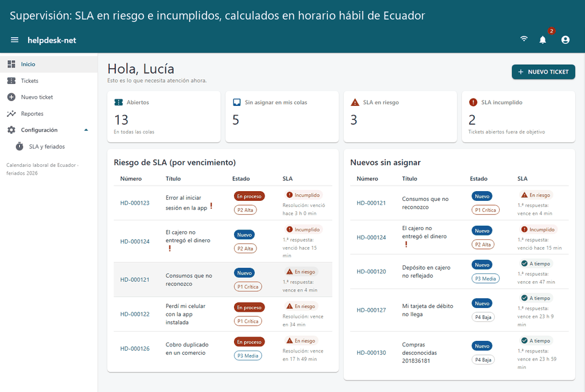
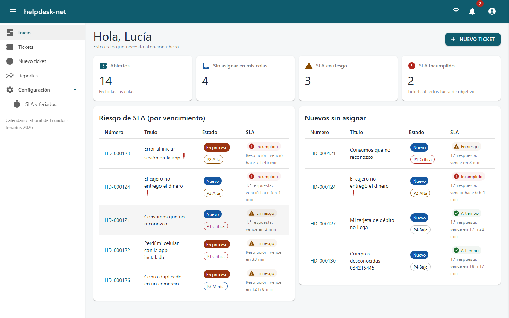
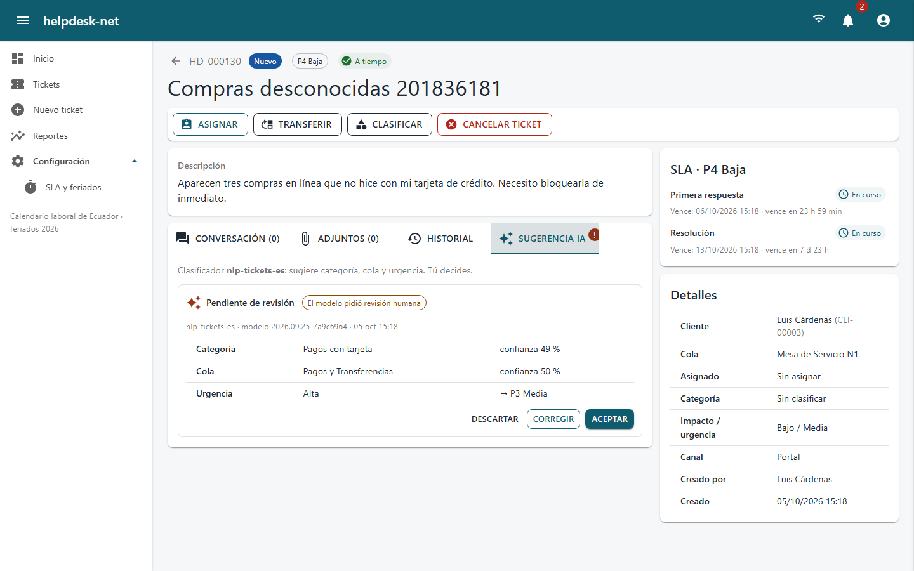
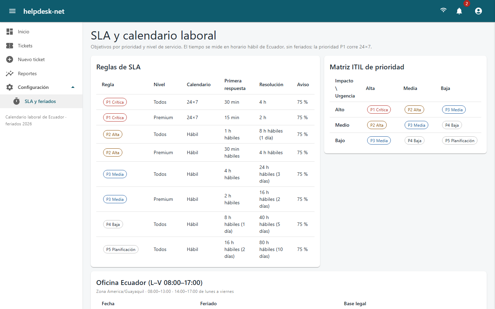
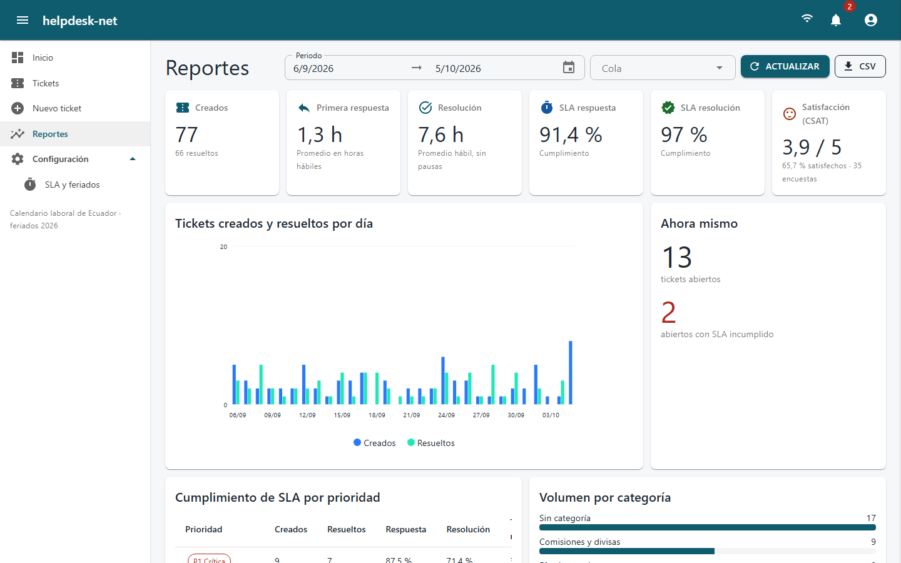
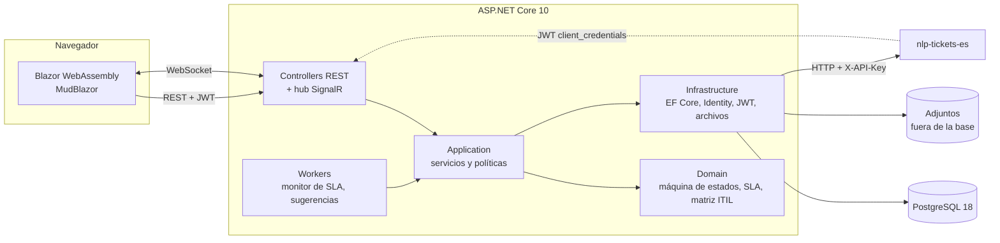
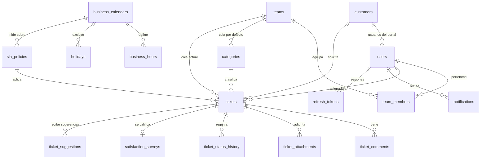

# helpdesk-net

Mesa de ayuda full-stack en .NET 10 y Blazor. Calcula el SLA sobre el calendario laboral y los feriados de Ecuador, avisa en tiempo real y usa un clasificador de IA que sugiere, pero no decide.


**Demo:** _pendiente de publicar_ (front en GitHub Pages, API en Render y base en Neon; ver [despliegue](docs/despliegue.md)).

**Usuarios de prueba** (datos 100 % ficticios). La contraseña se publica junto con la demo; en local es la que definas en `HELPDESK_DEMO_PASSWORD`.

| Rol | Correo |
|---|---|
| Supervisión | `supervisor@helpdesk.example` |
| Agente | `agente@helpdesk.example` |
| Cliente | `cliente@helpdesk.example` |
| Administración | `admin@helpdesk.example` |



| Tablero de supervisión | Sugerencia de IA con revisión humana |
|---|---|
|  |  |
| **SLA y calendario laboral** | **Reportes** |
|  |  |

## Problema que resuelve

En una mesa de ayuda bancaria, un correo o una hoja de cálculo no dicen qué caso vence primero. Un "4 horas" mal contado ignora el almuerzo, los fines de semana y los feriados nacionales (incluidos los que el Ejecutivo traslada por decreto). Cuando alguien nota el incumplimiento, ya es tarde.

helpdesk-net hace lo siguiente:
- Calcula la prioridad con la matriz ITIL de impacto × urgencia.
- Mide cada SLA en horas hábiles de Ecuador y lo pausa mientras se espera al cliente.
- Escala antes de vencer.
- Muestra todo en vivo a la persona que tiene que actuar.

También cumple la LOPDP: aviso de privacidad, minimización de datos y una IA que solo sugiere.

## Funcionalidades

- **Ciclo de vida ITIL** con máquina de estados explícita y probada.

  ```mermaid
  stateDiagram-v2
    [*] --> Nuevo
    Nuevo --> Asignado: asignar
    Asignado --> EnProceso: iniciar
    EnProceso --> EnEspera: esperar cliente o proveedor
    EnEspera --> EnProceso: reanudar
    EnProceso --> Resuelto: resolver
    Resuelto --> EnProceso: reabrir
    Resuelto --> Cerrado: confirmar o encuesta o 3 días hábiles
    Nuevo --> Cancelado
    Asignado --> Cancelado
    EnProceso --> Cancelado
    EnEspera --> Cancelado
  ```

- **SLA sobre calendario laboral**:
  - Lunes a viernes, de 08:00 a 13:00 y de 14:00 a 17:00, en `America/Guayaquil`.
  - Feriados 2026 con su base legal, incluidos los traslados por decreto.
  - P1 corre 24×7.
  - Objetivos distintos para primera respuesta y resolución, por prioridad y por nivel de cliente (estándar o premium).
  - Pausa en *En espera* y *Resuelto*.
  - Aviso al 75 % del objetivo; al incumplirlo escala a líderes y supervisión.
  - Cierre automático a los 3 días hábiles.
- **Tiempo real con SignalR**:
  - Listas, tableros y detalle se actualizan sin recargar.
  - Notificaciones con campana y aviso emergente.
  - Grupos por cola, por cliente y de supervisión. Los mensajes solo llevan identificadores.
- **Roles y acceso por recurso**:
  - El cliente ve solo sus tickets.
  - El agente ve solo los de sus colas.
  - La supervisión ve todo y reasigna.
  - Los comentarios y adjuntos internos nunca llegan al cliente.
- **Adjuntos seguros**: lista blanca y firma del archivo verificada, 5 MB como máximo, guardados fuera de la base con nombre aleatorio y descarga autorizada.
- **Integración con [nlp-tickets-es](https://github.com/DiegoFranciscoG/nlp-tickets-es)** (P27):
  - Al crearse un ticket sin categoría, un worker pide la clasificación.
  - El agente la **acepta**, la **corrige** o la **descarta**; la corrección vuelve al modelo como retroalimentación.
  - P27 también puede leer tickets sin clasificar y publicar sugerencias con un JWT de cliente (`client_credentials`).
- **Reportes**:
  - Tiempo medio de primera respuesta y de resolución en horas hábiles (MTTR).
  - Cumplimiento de SLA por prioridad, volumen por categoría y carga por agente.
  - CSAT y exportación CSV.
- **Encuesta de satisfacción** al resolver y **reapertura** por el cliente.
- **Administración**: reglas de SLA, feriados, usuarios, colas y anonimización de clientes (derecho de eliminación).

## Arquitectura



| Proyecto | Responsabilidad |
|---|---|
| `Helpdesk.Domain` | Entidades, máquina de estados, calendario laboral, políticas de SLA y matriz de prioridad. Sin dependencias. |
| `Helpdesk.Contracts` | DTO y validadores FluentValidation, compartidos por la API y el front. |
| `Helpdesk.Application` | Casos de uso, control de acceso por recurso, reportes y eventos de dominio. |
| `Helpdesk.Infrastructure` | EF Core + Npgsql, Identity, tokens, almacenamiento, cliente de P27 y workers. |
| `Helpdesk.Api` | Controllers, hub SignalR, seguridad (políticas, rate limiting, cabeceras) y errores. |
| `Helpdesk.Web` | Front Blazor WebAssembly. |

## Stack y por qué

| Capa | Tecnología | Motivo |
|---|---|---|
| Backend | .NET 10 LTS, ASP.NET Core, C# 14 | Soporte de 3 años; Identity, rate limiting, ProblemDetails y OpenAPI integrados. |
| Tiempo real | SignalR | WebSocket con *fallback*, autenticación con el mismo JWT y grupos por cola. Una sola instancia: no necesita backplane. |
| Persistencia | EF Core 10 + PostgreSQL 18 | Migraciones versionadas, concurrencia optimista con `xmin` y `CHECK` para la prioridad. La misma versión mayor en local y en Neon. |
| Front | Blazor WebAssembly + MudBlazor 9 | Comparte con la API los DTO, las validaciones y la matriz de prioridad, así que front y servidor nunca discrepan. Se publica como sitio estático gratis. |
| Validación | FluentValidation | Mismas reglas en el servidor y en los formularios. |
| Logs | Serilog (JSON compacto) | Eventos estructurados con `traceId`, sin datos sensibles. |
| Pruebas | xUnit v3, Testcontainers, WireMock.Net, bUnit, Playwright | PostgreSQL real en integración, P27 simulado con WireMock y el flujo completo en navegadores reales. |
| DevOps | Docker multi-stage, GitHub Actions | Imágenes *chiseled* y *nginx-unprivileged* sin root; CI con gitleaks, cobertura, Trivy y e2e sobre `docker compose`. |

## Modelo de datos

Detalle de cada tabla, restricciones y reglas con su fuente en [docs/modelo-datos.md](docs/modelo-datos.md), derivado de [docs/investigacion.md](docs/investigacion.md).



## Cómo ejecutar en local

**Con Docker** (API, front y PostgreSQL con datos demo):

```bash
cp .env.example .env
docker compose up --build
```

- Completa en `.env` los tres valores obligatorios. Cada secreto se genera con `openssl rand -base64 48`. Sin ellos, compose no arranca.
- Front: http://localhost:5173
- API y documentación interactiva: http://localhost:5080/docs

Para conectar el clasificador, levanta [nlp-tickets-es](https://github.com/DiegoFranciscoG/nlp-tickets-es) y define `HELPDESK_NLP_URL=http://host.docker.internal:8000` y su API key.

**Sin Docker** (requiere el SDK de .NET 10 y un PostgreSQL 18):

```bash
export ConnectionStrings__Helpdesk="Host=localhost;Port=5432;Database=helpdesk;Username=helpdesk;Password=..."
export Jwt__SigningKey="$(openssl rand -base64 48)"
export Seed__DemoPassword="..."   # 15+ caracteres
export Database__SeedDemoData=true
dotnet run --project src/Helpdesk.Api --launch-profile http   # http://localhost:5080 (aplica migraciones en Development)
dotnet run --project src/Helpdesk.Web --launch-profile http   # http://localhost:5173
```

## Variables de entorno

Las de compose llevan el prefijo `HELPDESK_` para que una variable global del sistema no pise la del proyecto.

| Variable (compose) | Variable de la API | Descripción | Obligatoria |
|---|---|---|---|
| `HELPDESK_DB_PASSWORD` | `ConnectionStrings__Helpdesk` | Contraseña de PostgreSQL. La API recibe la cadena completa. | Sí |
| `HELPDESK_JWT_SIGNING_KEY` | `Jwt__SigningKey` | Clave HS256 de al menos 32 bytes aleatorios. | Sí |
| `HELPDESK_DEMO_PASSWORD` | `Seed__DemoPassword` | Contraseña de los usuarios demo (15+ caracteres). | Sí, con datos demo |
| `HELPDESK_INTEGRATION_CLIENT_SECRET` | `Integration__ClientSecret` | Secreto del cliente `nlp-tickets-es` (32+ caracteres). | No |
| `HELPDESK_NLP_URL` | `Nlp__BaseUrl` | URL del clasificador P27. Vacía, la integración queda desactivada. | No |
| `HELPDESK_NLP_API_KEY` | `Nlp__ApiKey` | API key de P27 con rol `client`. | Con P27 |
| `HELPDESK_NLP_REVIEWER_API_KEY` | `Nlp__ReviewerApiKey` | API key de P27 con rol `reviewer`, para enviar las correcciones. | No |
| `HELPDESK_AUTH_RATE_LIMIT` | `RateLimiting__AuthPerMinute` | Logins por minuto e IP (5). | No |
| `HELPDESK_REFRESH_RATE_LIMIT` | `RateLimiting__RefreshPerMinute` | Renovaciones de sesión por minuto e IP (30). | No |
| `HELPDESK_API_URL` | — | Origen de la API para el contenedor del front. Se valida al arrancar. | Sí (imagen web) |

Otras opciones de la API: `Cors__AllowedOrigins`, `Database__ApplyMigrationsOnStartup`, `Database__SeedDemoData`, `ReverseProxy__TrustForwardedHeaders`, `Storage__AttachmentsPath` y `Bootstrap__AdminEmail`/`Bootstrap__AdminPassword` (primer administrador sin datos demo).

## API

- Documentación interactiva (Scalar): `http://localhost:5080/docs`
- OpenAPI: `http://localhost:5080/openapi/v1.json`
- Colección de ejemplos: [docs/api.http](docs/api.http), ejecutable en Visual Studio o con REST Client. Se verificó completa contra el stack de Docker.

| Método | Ruta | Descripción |
|---|---|---|
| POST | `/api/v1/auth/login` · `/refresh` · `/logout` | Sesión con JWT de 15 min y refresh token rotado. |
| POST | `/api/v1/auth/token` | JWT de integración (`client_credentials`) para P27. |
| POST | `/api/v1/auth/privacy-consent` | Aceptación del aviso de privacidad (LOPDP). |
| GET | `/api/v1/tickets` | Listado con filtros por estado, prioridad, cola, SLA y búsqueda, con orden y paginación. |
| POST | `/api/v1/tickets` | Alta. La prioridad y los vencimientos los calcula el servidor. |
| GET | `/api/v1/tickets/{id}` | Detalle con SLA, historial y acciones permitidas. Devuelve `ETag`. |
| POST | `/api/v1/tickets/{id}/assign` · `/transfer` · `/transitions` | Asignar, cambiar de cola y transicionar. Exigen `If-Match`. |
| POST | `/api/v1/tickets/{id}/comments` · `/attachments` · `/survey` | Conversación pública o interna, adjuntos y encuesta CSAT. |
| GET/POST | `/api/v1/tickets/{id}/suggestions` · `/api/v1/suggestions/{id}/accept\|correct\|dismiss` | Revisión humana de las sugerencias de IA. |
| GET/POST | `/api/v1/integration/tickets/unclassified` · `/{id}/suggestions` | Endpoints para P27, solo con el rol `Integration`. |
| GET | `/api/v1/reports/overview` · `/agents` · `/tickets.csv` | Reportes y exportación. |
| GET/PUT | `/api/v1/sla-policies` · `/api/v1/calendars/{id}/holidays` | Reglas de SLA y feriados (administración). |
| WS | `/hubs/notifications` | Hub SignalR: `TicketChanged` y `NotificationReceived`. |

## Tests y cobertura

```bash
dotnet test --solution Helpdesk.slnx   # unitarias, bUnit e integración (las de integración necesitan Docker)
```

| Proyecto | Pruebas | Qué cubre |
|---|---|---|
| `Helpdesk.UnitTests` | 235 | Máquina de estados, calendario laboral con feriados y almuerzo, SLA con pausas, matriz ITIL, políticas de acceso, reportes, validadores y política de contraseñas. |
| `Helpdesk.Web.Tests` | 26 | Componentes Blazor con bUnit (chips de estado, tabla de tickets, textos de SLA) y validación del `returnUrl`. |
| `Helpdesk.IntegrationTests` | 60 | API real sobre PostgreSQL (Testcontainers): ciclo completo, BOLA, `If-Match`, rate limiting, refresh tokens, adjuntos maliciosos, SignalR, reportes y P27 simulado con WireMock. |
| `Helpdesk.E2ETests` | 6 | Playwright contra el stack levantado: flujo en vivo con tres navegadores, transferencia de cola, tablero, permisos y sugerencia real de P27. |

Las e2e se activan con variables de entorno, así que `dotnet test` sigue funcionando sin navegador:

```bash
HELPDESK_E2E_WEB_URL=http://localhost:5173 HELPDESK_E2E_PASSWORD=... dotnet test --project tests/Helpdesk.E2ETests
```

Cobertura de líneas de la lógica de negocio (Domain + Application): **93 %**. CI exige al menos 70 % (coverlet + ReportGenerator).

## Despliegue

Gratis y sin tarjeta, con los límites verificados en las fuentes oficiales:

| Servicio | Qué corre | Límite clave |
|---|---|---|
| GitHub Pages | Front Blazor WebAssembly, publicado por [workflow](.github/workflows/pages.yml) | Sitio de 1 GB y 100 GB/mes; el front pesa ~22 MB. |
| Render (free) | API en Docker ([`render.yaml`](render.yaml)) | Se duerme a los 15 min sin tráfico y tarda ~1 min en despertar; sistema de archivos efímero. |
| Neon (free) | PostgreSQL 18 | 1 GB y 100 CU-h por proyecto; *scale to zero*. |

Paso a paso y consecuencias de cada límite: [docs/despliegue.md](docs/despliegue.md).

## Seguridad aplicada

Resumen. El detalle está en [SECURITY.md](SECURITY.md), con referencias a OWASP Top 10:2025, API Security Top 10 y Top 10 for LLM Applications.

- **Secretos** solo por entorno, sin valores por defecto: la API, compose y el front se niegan a arrancar sin ellos. gitleaks corre en CI y en pre-commit.
- **Autenticación**:
  - Identity con PBKDF2-SHA512 de 220 000 iteraciones y política NIST SP 800-63B-4: 15–128 caracteres, sin reglas de composición; se rechazan contraseñas comunes, secuenciales o con el nombre o el correo.
  - Bloqueo tras 5 fallos.
  - JWT de 15 min y refresh token opaco rotado, con detección de reutilización (RFC 9700).
- **Autorización deny-by-default** y control por recurso: un ticket ajeno responde 404 (BOLA).
- **Concurrencia optimista** con `If-Match`.
- **Rate limiting** en login, refresh, subidas y global.
- **Validación** compartida, SQL parametrizado, `ProblemDetails` sin stack traces y CSV protegido contra inyección de fórmulas.
- **Cabeceras**: CSP estricta en la API y en el front, HSTS y CORS con orígenes explícitos.
- **Adjuntos** verificados por firma y servidos como descarga con CSP `sandbox`.
- **LOPDP**:
  - Aviso de privacidad versionado antes de registrar solicitudes; sin cédula ni RUC.
  - Anonimización a pedido del titular.
  - P27 como encargado, y la IA nunca decide sola (art. 20).
- **Contenedores** sin root y con versiones fijas; Trivy y hadolint en CI; acciones de GitHub fijadas por SHA.

## Decisiones técnicas

- **SLA en el dominio, no en SQL.** El cálculo de horas hábiles (almuerzo, fines de semana, feriados, pausas) vive en clases puras, probadas caso por caso: feriado trasladado por decreto, ticket creado un sábado o antes de abrir, tiempo en espera sumado al objetivo. Una prueba con entradas aleatorias comprueba que sumar minutos hábiles y medirlos de vuelta da lo mismo.
  - El vencimiento se guarda al abrir el ticket y al pausar o reclasificar, para poder filtrar por SLA en SQL.
  - *Descartado*: calcular en cada consulta, que es más lento y difícil de probar.
- **Prioridad calculada, nunca elegida.** `priority = impact + urgency − 1` vive en el dominio y además como `CHECK` en la base.
  - El front muestra la misma matriz porque comparte el código.
- **Blazor WebAssembly en lugar de Blazor Server.** El front es estático (GitHub Pages gratis) y el servidor no mantiene un circuito por usuario.
  - El costo es la primera descarga, ~22 MB con versiones comprimidas.
  - Las e2e sobre la imagen de producción detectaron que el *trimming* borraba constructores de los DTO. Se preservan explícitamente los ensamblados compartidos.
- **Refresh token en `sessionStorage` y access token en memoria** (RFC 10017).
  - *Descartada* la cookie HttpOnly: el front y la API viven en sitios distintos y los navegadores bloquean cada vez más las cookies de terceros.
  - La reutilización revoca la familia. Una ventana de gracia de 30 s cubre la recarga de la pestaña con la rotación en vuelo.
- **Consentimiento contra la base, no contra el token.** Un JWT emitido antes de aceptar el aviso sigue vigente 15 minutos. Verificarlo en la base evita rechazar al usuario que acaba de aceptar.
- **404 en lugar de 403 para recursos ajenos.** No confirma que el ticket exista (OWASP API1).
- **La IA sugiere y el humano decide.** La respuesta de P27 se valida como no confiable (códigos, puntajes y tamaño).
  - Con baja confianza, el modelo pide revisión humana y la interfaz lo muestra.
- **Una instancia, sin Redis.** El plan free de Render tiene una sola instancia: SignalR y el rate limiting en memoria bastan. Escalar a más réplicas exige un backplane (ver *roadmap*).

## Roadmap

- [ ] Adjuntos en almacenamiento de objetos, porque Render free pierde el disco al reiniciar.
- [ ] Backplane de SignalR y rate limiting distribuido (Redis) para varias réplicas.
- [ ] Recarga periódica de la bandeja demo, para que siempre muestre casos en riesgo.
- [ ] Notificaciones por correo con plantillas y preferencias por usuario.
- [ ] Calendarios por cliente o por región, con feriados locales (cantonales).
- [ ] Base de conocimiento: sugerir artículos con la búsqueda semántica de P27.

## Fuentes de datos y licencias

- **ITIL 4** y **ISO/IEC 20000-1**: gestión de incidentes, matriz de prioridad y SLA (referencia conceptual).
- **Código del Trabajo** (art. 65) y **decretos ejecutivos** de traslado de feriados 2026, de Ecuador.
- **LOPDP** (R.O. Suplemento 459, 26-may-2021) y su **Reglamento** (D.E. 904, 2023).
- **OWASP** Top 10:2025, API Security Top 10:2023, Top 10 for LLM Applications 2025 y Cheat Sheets. **NIST SP 800-63B-4**. **IETF RFC 9700** y **RFC 10017**.
- Documentación oficial de .NET, ASP.NET Core, EF Core, SignalR, Render, Neon y GitHub Pages.
- Todos los datos demo son ficticios (dominios reservados `.example`). No se usa ningún dataset externo.
- Todas las fuentes, con URL, fecha de consulta y la regla que se tomó de cada una: [docs/investigacion.md](docs/investigacion.md).

## Autor

**Diego Francisco Granda Zhingre** · [GitHub](https://github.com/DiegoFranciscoG) · [LinkedIn](https://www.linkedin.com/in/diego-francisco-g-61b793254/) · [Portafolio](https://diegofranciscog.github.io/)

Licencia [MIT](LICENSE).
