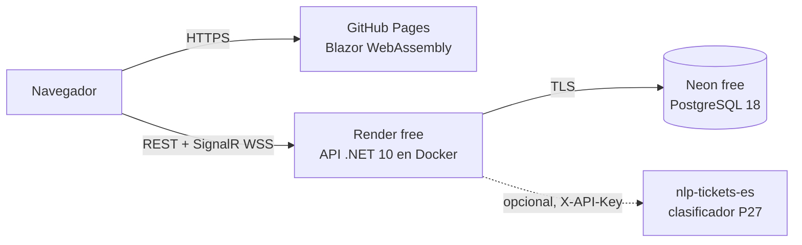

# Despliegue gratuito

El front se publica en **GitHub Pages**, la API en **Render** (Docker, plan free) y la base de datos en **Neon** (PostgreSQL 18, plan free). Ninguno de los tres exige tarjeta. Los límites se verificaron en las fuentes oficiales; la tabla completa está en [`investigacion.md`](investigacion.md), filas 40 a 46.



## Límites que condicionan el diseño

| Servicio | Límite del plan gratis | Consecuencia en helpdesk-net |
|---|---|---|
| Render | La API se duerme tras 15 min sin tráfico HTTP ni mensajes WebSocket; tarda cerca de 1 min en despertar. | El primer login del día puede tardar ~1 min. Mientras haya una pestaña abierta, SignalR la mantiene despierta. |
| Render | 750 h/mes por workspace; una sola instancia. | Alcanza para un servicio encendido todo el mes. SignalR no necesita backplane. |
| Render | Sistema de archivos efímero, sin discos persistentes. | Los adjuntos de la demo se pierden al redeplegar o al dormirse la API. En producción se usaría un disco o un almacenamiento de objetos (ver *roadmap*). |
| Render | El monitor de SLA solo corre con la API despierta. | Al despertar, la primera pasada recalcula todos los tickets abiertos: los avisos e incumplimientos atrasados se emiten entonces. |
| Neon | 1 GB por proyecto, 100 CU-h por proyecto al mes y *scale to zero* a los 5 min. | Los datos demo ocupan pocos MB. La base se suspende sola y despierta en la primera consulta. |
| GitHub Pages | Sitio de 1 GB, 100 GB/mes de ancho de banda (*soft*) y 10 builds/hora. | El front publicado pesa ~22 MB, incluidas sus versiones comprimidas. |

## 1. Base de datos en Neon

1. Crea un proyecto con **PostgreSQL 18** en la región **AWS US East (N. Virginia)**, la misma zona que la API.
2. Crea una base `helpdesk`.
3. En *Connect*, copia la cadena del endpoint **directo**, sin `-pooler` en el host. Neon pide conexión directa para las migraciones: su *pooler* (PgBouncer en modo transacción) no mantiene estado de sesión ni bloqueos *advisory* de sesión. La API aplica las migraciones al arrancar, y con una sola instancia y pocas conexiones el *pooler* no aporta.
4. Pásala al formato de Npgsql:

   ```text
   Host=ep-xxxx.us-east-1.aws.neon.tech;Database=helpdesk;Username=helpdesk_owner;Password=...;SSL Mode=Require
   ```

No hace falta crear tablas: la API aplica las migraciones y siembra los datos demo al arrancar.

## 2. API en Render

1. En Render: *New › Blueprint*, elige el repositorio. Render lee [`render.yaml`](../render.yaml).
2. Completa las variables marcadas con `sync: false`:

   | Variable | Valor |
   |---|---|
   | `ConnectionStrings__Helpdesk` | La cadena de Neon del paso anterior. |
   | `Seed__DemoPassword` | Contraseña de los usuarios demo: 15 caracteres o más, sin el nombre ni el correo. |
   | `Nlp__BaseUrl`, `Nlp__ApiKey`, `Nlp__ReviewerApiKey` | Opcionales: URL y claves del clasificador P27. Déjalas vacías para desactivarlo. |

   Render genera `Jwt__SigningKey` e `Integration__ClientSecret` (256 bits aleatorios). Nunca se escriben en el repositorio.
3. Espera a que el *health check* (`/health/live`) quede en verde.
4. Comprueba:
   - `https://<servicio>.onrender.com/health/ready` responde `Healthy`.
   - `https://<servicio>.onrender.com/docs` abre la documentación interactiva.

Si el front vive en otro origen (un dominio propio, por ejemplo), cambia `Cors__AllowedOrigins`. Acepta varios orígenes separados por comas y rechaza `*`.

## 3. Front en GitHub Pages

1. *Settings › Pages › Build and deployment*: en *Source* elige **GitHub Actions**.
2. *Settings › Secrets and variables › Actions › Variables*: crea la variable de repositorio `HELPDESK_API_URL` con el origen de la API, por ejemplo `https://helpdesk-net-api.onrender.com`. Es pública por naturaleza: termina en el navegador. No es un secreto.
3. Ejecuta el workflow *Front en GitHub Pages* (o haz push a `main`). El workflow hace lo siguiente:
   - Publica la app y ajusta `<base href>` a `/helpdesk-net/`.
   - Escribe `appsettings.json` con la URL de la API.
   - Copia `index.html` como `404.html` para que funcionen los enlaces directos.
   - Agrega `.nojekyll` para que Pages sirva la carpeta `_framework`.
4. Abre `https://diegofranciscog.github.io/helpdesk-net/` e inicia sesión con un usuario demo.

GitHub Pages no permite cabeceras propias, así que la CSP del front llega como `<meta>`, generada a partir de la URL de la API. En la imagen Docker (nginx), la CSP y el resto de cabeceras se envían como cabeceras HTTP reales.

## 4. Verificación

- Las pruebas e2e se pueden apuntar al despliegue. Sube antes `RateLimiting__AuthPerMinute` y `RateLimiting__RefreshPerMinute` solo mientras corren (todos los navegadores salen de una misma IP):

  ```bash
  HELPDESK_E2E_WEB_URL=https://diegofranciscog.github.io/helpdesk-net HELPDESK_E2E_PASSWORD=... dotnet test --project tests/Helpdesk.E2ETests
  ```

- La colección [`api.http`](api.http) funciona contra Render cambiando `@baseUrl`.

## Operación

- **Reiniciar la demo**: en Neon, restaura la rama al estado inicial o borra y vuelve a crear la base `helpdesk`. Al siguiente arranque, la API recrea el esquema y los datos ficticios, incluida la bandeja "en vivo" con tickets en riesgo e incumplidos relativos a esa hora.
- **Rotar secretos**: cambia el valor en el panel de Render y redespliega.
  - Rotar `Jwt__SigningKey` invalida todos los access tokens.
  - Los refresh tokens viven en la base y se revocan desde la propia API (desactivar el usuario o cerrar sesión).
- **Logs**: Render muestra el JSON de Serilog. Cada error lleva el `traceId` que también recibe el cliente en `ProblemDetails`.
