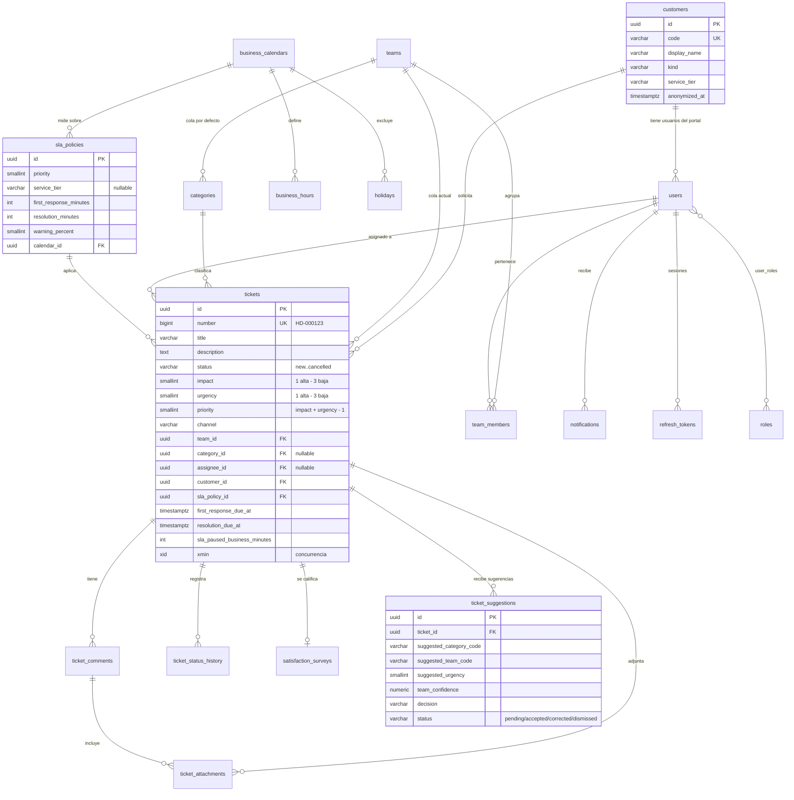

# Modelo de datos

PostgreSQL 18 con EF Core 10 (Npgsql) y migraciones versionadas en `src/Helpdesk.Infrastructure/Persistence/Migrations`. Nombres en `snake_case`, claves **UUIDv7** generadas en la aplicación, fechas en `timestamptz` (UTC) y enumeraciones guardadas como texto con `CHECK`. Las reglas (R…) y fuentes (#…) remiten a [investigacion.md](investigacion.md).

## Identidad y acceso

| Tabla | Campo | Tipo | Restricción | Regla / fuente |
|---|---|---|---|---|
| `users` | `id` | uuid | PK (UUIDv7) | #11 |
| | `user_name`, `normalized_user_name` | varchar(256) | único (normalizado) | Identity (#16) |
| | `email`, `normalized_email` | varchar(256) | único (normalizado) | Identity |
| | `password_hash` | text | PBKDF2-HMAC-SHA512, 220 000 iteraciones | R11, #35 |
| | `security_stamp`, `concurrency_stamp` | text | Identity | #16 |
| | `lockout_end`, `lockout_enabled`, `access_failed_count` | timestamptz, bool, int | 5 fallos → 15 min | R11 |
| | `full_name` | varchar(120) | not null | Minimización (#38 art. 10 e) |
| | `customer_id` | uuid | FK `customers`, null para personal interno | Rol Customer exige valor (servicio) |
| | `is_active` | bool | default true | Baja lógica sin borrar historial |
| | `privacy_notice_version`, `privacy_notice_accepted_at` | varchar(20), timestamptz | null hasta aceptar | R13, #38 arts. 10 c, 12 |
| | `created_at`, `last_login_at` | timestamptz | | Auditoría |
| `roles` | `id`, `name`, `normalized_name` | uuid, varchar(256) | sembrados: Admin, Supervisor, Agent, Customer | Autorización por políticas |
| `user_roles` | `user_id`, `role_id` | uuid | PK compuesta | Identity |
| `user_claims`, `role_claims`, `user_logins`, `user_tokens` | | | tablas estándar de Identity (sin uso de datos personales extra) | #16 |
| `refresh_tokens` | `id` | uuid | PK | R12 |
| | `user_id` | uuid | FK `users` ON DELETE CASCADE, índice | |
| | `token_hash` | char(64) | único; SHA-256 del token (el token en claro nunca se guarda) | #37 |
| | `family_id` | uuid | índice; cadena de rotación | #37 §4.14 |
| | `created_at`, `expires_at` | timestamptz | `expires_at` = inicio de la familia + 8 h | R12, #14 |
| | `revoked_at`, `revoked_reason`, `replaced_by_id` | timestamptz, varchar(40), uuid | reutilización ⇒ se revoca toda la familia | #37 |
| `api_clients` | `id` | uuid | PK | Cliente de integración (P27 u otro) |
| | `client_id` | varchar(64) | único | |
| | `display_name` | varchar(80) | | |
| | `secret_hash` | text | hash PBKDF2 del secreto (se siembra desde variables de entorno) | R11 |
| | `scopes` | text[] | p. ej. `tickets:read`, `suggestions:write` | Mínimo privilegio |
| | `is_active`, `created_at`, `last_used_at` | bool, timestamptz | | |

## Catálogos

| Tabla | Campo | Tipo | Restricción | Regla / fuente |
|---|---|---|---|---|
| `teams` (colas) | `id` | uuid | PK | |
| | `code` | varchar(40) | único; coincide con los códigos de equipo de P27 + `service_desk` (primer nivel) | #44 |
| | `name`, `description` | varchar(80), varchar(300) | | |
| | `is_active`, `created_at` | bool, timestamptz | | |
| `team_members` | `team_id`, `user_id` | uuid | PK compuesta; FK con CASCADE | |
| | `is_lead` | bool | los líderes reciben el escalamiento | R8 |
| `categories` | `id` | uuid | PK | |
| | `code` | varchar(40) | único; códigos de categoría de P27 + `general` | #44 |
| | `name`, `description` | varchar(80), varchar(300) | | |
| | `default_team_id` | uuid | FK `teams` RESTRICT | Enrutamiento por defecto |
| | `is_active` | bool | | |
| `customers` | `id` | uuid | PK | |
| | `code` | varchar(20) | único (`CLI-00001`) | Identificador sin datos personales para reportes y CSV |
| | `display_name` | varchar(120) | not null | Minimización: **sin cédula ni RUC** (#38 art. 10 e) |
| | `kind` | varchar(20) | CHECK `person`/`organization` | |
| | `email`, `phone` | varchar(254), varchar(20) | opcionales | |
| | `service_tier` | varchar(20) | CHECK `standard`/`premium` | Selección de SLA (R2) |
| | `is_active`, `created_at` | bool, timestamptz | | |
| | `anonymized_at` | timestamptz | se llena al ejercer el derecho de eliminación | R13, #38 art. 15 |

## Calendario y SLA

| Tabla | Campo | Tipo | Restricción | Regla / fuente |
|---|---|---|---|---|
| `business_calendars` | `id` | uuid | PK | |
| | `code` | varchar(40) | único (`ec-office`, `24x7`) | |
| | `name` | varchar(80) | | |
| | `time_zone` | varchar(64) | zona IANA (`America/Guayaquil`) | #31 |
| | `is_24x7` | bool | si es true se ignoran horarios y feriados | R3 |
| `business_hours` | `id` | uuid | PK | |
| | `calendar_id` | uuid | FK CASCADE | |
| | `day_of_week` | smallint | CHECK 1–7 (ISO, 1 = lunes) | #27 |
| | `start_time`, `end_time` | time | CHECK `end_time > start_time`; único (`calendar_id`, `day_of_week`, `start_time`) | R3, S2 |
| `holidays` | `id` | uuid | PK | |
| | `calendar_id` | uuid | FK CASCADE | |
| | `date` | date | único por calendario | R4 |
| | `name` | varchar(120) | | |
| | `legal_basis` | varchar(200) | p. ej. "Código del Trabajo art. 65 (traslado)", "Decreto Ejecutivo 249" | #28, #30 |
| `sla_policies` (reglas_sla) | `id` | uuid | PK | |
| | `name` | varchar(80) | | |
| | `priority` | smallint | CHECK 1–5 | R1 |
| | `service_tier` | varchar(20) | null = cualquier nivel; único (`priority`, `service_tier`) **NULLS NOT DISTINCT** | R2 |
| | `first_response_minutes` | int | CHECK > 0 | S1 |
| | `resolution_minutes` | int | CHECK ≥ `first_response_minutes` | S1 |
| | `warning_percent` | smallint | CHECK 50–95 (por defecto 75) | R8 |
| | `calendar_id` | uuid | FK RESTRICT | R3 |
| | `is_active` | bool | | |

## Tickets

| Tabla | Campo | Tipo | Restricción | Regla / fuente |
|---|---|---|---|---|
| `tickets` | `id` | uuid | PK (UUIDv7: no enumerable) | #11, #33 API1 |
| | `number` | bigint | único; secuencia `ticket_number_seq`; se muestra `HD-000123` | |
| | `title` | varchar(150) | not null | |
| | `description` | text | not null (≤ 8 000 caracteres, validado en el DTO) | #33 API4 |
| | `status` | varchar(20) | CHECK `new`, `assigned`, `in_progress`, `on_hold`, `resolved`, `closed`, `cancelled` | R5 |
| | `channel` | varchar(20) | CHECK `portal`, `email`, `phone`, `chat`, `walk_in` | |
| | `impact`, `urgency` | smallint | CHECK 1–3 (1 = alta) | R1, #24 |
| | `priority` | smallint | CHECK 1–5 **y** `priority = impact + urgency - 1` | R1, #24, #25 |
| | `category_id` | uuid | FK RESTRICT, null hasta clasificar | |
| | `team_id` | uuid | FK RESTRICT, not null (cola) | |
| | `assignee_id` | uuid | FK `users` SET NULL | |
| | `customer_id` | uuid | FK RESTRICT | |
| | `created_by_id` | uuid | FK `users` RESTRICT | |
| | `sla_policy_id` | uuid | FK RESTRICT | R2 |
| | `first_response_due_at`, `first_response_warning_at` | timestamptz | calculados con el calendario de la regla | R2, R8 |
| | `first_responded_at` | timestamptz | null hasta la primera respuesta | R7 |
| | `first_response_breached`, `response_warning_sent` | bool | | R8 |
| | `first_response_business_minutes` | int | minutos hábiles hasta responder (reportes) | R15 |
| | `resolution_due_at`, `resolution_warning_at` | timestamptz | se recalculan al pausar/reanudar/reclasificar | R6 |
| | `sla_paused_at` | timestamptz | no nulo mientras está en espera o resuelto | R6 |
| | `sla_paused_business_minutes` | int | CHECK ≥ 0; acumulado de pausas | R6 |
| | `resolved_at`, `resolution_breached`, `resolution_warning_sent` | timestamptz, bool, bool | | R8 |
| | `resolution_business_minutes` | int | minutos hábiles netos de pausas | R15 |
| | `resolution_summary` | varchar(2000) | obligatorio al resolver (visible al cliente) | |
| | `escalation_level` | smallint | CHECK 0–2 | R8 |
| | `reopen_count` | smallint | CHECK ≥ 0 | R5 |
| | `auto_close_at`, `closed_at` | timestamptz | `auto_close_at` = resuelto + 3 días hábiles | R9 |
| | `created_at`, `updated_at` | timestamptz | | |
| | `xmin` | xid | token de concurrencia optimista | #20 |
| `ticket_comments` | `id` | uuid | PK | |
| | `ticket_id` | uuid | FK CASCADE; índice (`ticket_id`, `created_at`) | |
| | `author_id` | uuid | FK `users` RESTRICT | |
| | `body` | text | 1–5 000 caracteres | |
| | `is_internal` | bool | los clientes nunca ven ni crean comentarios internos | #33 API3 |
| | `created_at` | timestamptz | | |
| `ticket_attachments` | `id` | uuid | PK | R10 |
| | `ticket_id` | uuid | FK CASCADE | |
| | `comment_id` | uuid | FK SET NULL | |
| | `uploaded_by_id` | uuid | FK `users` RESTRICT | |
| | `original_file_name` | varchar(255) | saneado (sin rutas ni caracteres de control) | #34 |
| | `content_type` | varchar(100) | **detectado por firma**, no el enviado por el cliente | #34 |
| | `size_bytes` | bigint | CHECK 1 – 5 242 880 | #34 |
| | `sha256` | char(64) | integridad | |
| | `storage_key` | varchar(100) | único; nombre aleatorio fuera de la base | #34 |
| | `is_internal` | bool | hereda la visibilidad del comentario | |
| | `created_at` | timestamptz | | |
| `ticket_status_history` (historial_estados) | `id` | uuid | PK | |
| | `ticket_id` | uuid | FK CASCADE; índice (`ticket_id`, `changed_at`) | |
| | `from_status` | varchar(20) | null en la creación | R5 |
| | `to_status` | varchar(20) | not null | R5 |
| | `changed_by_id` | uuid | FK `users` SET NULL; null = sistema (cierre automático) | |
| | `reason` | varchar(500) | obligatorio en espera, cancelación, reapertura y transferencia | |
| | `changed_at` | timestamptz | | |
| `satisfaction_surveys` (encuestas_satisfaccion) | `id` | uuid | PK | R14 |
| | `ticket_id` | uuid | **único**, FK CASCADE | Una por ticket |
| | `rating` | smallint | CHECK 1–5 | #26 |
| | `comment` | varchar(1000) | opcional | |
| | `submitted_by_id` | uuid | FK `users` | |
| | `submitted_at` | timestamptz | | |
| `ticket_suggestions` | `id` | uuid | PK | R13 |
| | `ticket_id` | uuid | FK CASCADE; **único parcial** donde `status = 'pending'` | Una pendiente a la vez |
| | `source` | varchar(20) | CHECK `nlp_api` (P34 llama a P27) / `integration` (cliente JWT empuja) | #44 |
| | `provider`, `model_version` | varchar(60) | trazabilidad del modelo | #38 art. 20 |
| | `external_prediction_id` | uuid | `prediction_id` de P27 para enviar la corrección | #44 |
| | `suggested_category_code`, `suggested_team_code` | varchar(40) | | |
| | `suggested_urgency` | smallint | CHECK 1–3 | |
| | `category_confidence`, `team_confidence` | numeric(4,3) | CHECK 0–1 | |
| | `decision` | varchar(20) | `auto_route` / `human_review` (informativo: nunca se aplica solo) | #38 art. 20 |
| | `review_reasons` | text[] | | |
| | `status` | varchar(20) | CHECK `pending`, `accepted`, `corrected`, `dismissed` | |
| | `final_category_id`, `final_team_id`, `final_urgency` | uuid, uuid, smallint | lo que decidió el agente | |
| | `reviewed_by_id`, `reviewed_at` | uuid, timestamptz | | |
| | `created_at` | timestamptz | | |
| `notifications` | `id` | uuid | PK | |
| | `user_id` | uuid | FK CASCADE; índice (`user_id`, `is_read`, `created_at`) | |
| | `ticket_id` | uuid | FK CASCADE | |
| | `type` | varchar(40) | CHECK `ticket_created`, `ticket_assigned`, `status_changed`, `comment_added`, `sla_warning`, `sla_breached`, `suggestion_ready` | R8 |
| | `title`, `message` | varchar(150), varchar(500) | sin datos personales del cliente | #38 art. 10 e |
| | `is_read`, `created_at` | bool, timestamptz | | |

## Datos de referencia sembrados por migración

- **Roles:** Admin, Supervisor, Agent, Customer.
- **Equipos (7):** `service_desk` (Mesa de Servicio N1) y los 6 equipos de P27 (`card_operations`, `digital_support`, `payments_transfers`, `fraud_security`, `kyc_compliance`, `customer_care`).
- **Categorías (10):** las 9 de P27 (`cards`, `digital_channels`, `card_payments`, `cash_atm`, `transfers`, `top_ups`, `fees_fx`, `security_fraud`, `account_kyc`) y `general`, cada una con su cola por defecto.
- **Calendarios:** `ec-office` (lunes–viernes 08:00–13:00 y 14:00–17:00, `America/Guayaquil`) y `24x7`.
- **Feriados 2026** del calendario oficial con su base legal (R4).
- **Reglas de SLA:** 5 generales (una por prioridad) y 3 *premium* (P1–P3).

Los **datos demo** (clientes, usuarios y ~120 tickets ficticios con historial de 60 días) los crea `DemoDataSeeder` solo si `SEED_DEMO_DATA=true`. Todos los nombres, correos (`@helpdesk.example`, dominio reservado por RFC 2606) y textos son inventados.

## Reglas de integridad que vive en el dominio (y se prueban)

- Transiciones válidas de la máquina de estados y quién puede ejecutarlas (R5).
- Cálculo de vencimientos con calendario, feriados y pausas (R2, R3, R4, R6).
- Selección de la regla de SLA más específica (R2).
- Validación de adjuntos por firma, tamaño y nombre (R10).
